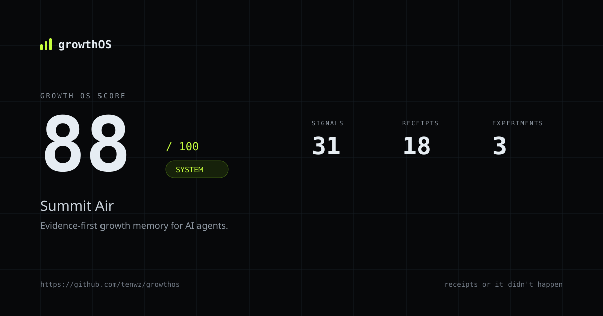

# growthOS

**Marketing Skills 教 Agent 怎么说话。growthOS 给它记忆、收据和记分牌。**

[](https://github.com/tenwz/growthos/actions/workflows/ci.yml)
[](https://www.npmjs.com/package/growthos)
[](LICENSE)
[](package.json)

Growth OS 是一个**你的 Coding Agent 能读懂的文件夹**：真实的客户信号、每条都能追溯到信号的 memo、以决策收尾的实验，以及每周给整个系统打分的 cockpit。

没有 SaaS，没有数据库，没有爬虫。只有 Markdown、YAML、一个 CLI，和 MCP。

```bash
npx growthos demo
```

```text
Auditing 2 memos...
  FAIL  growth/memos/2026-11-03-draft-missed-call-ai.md
        Claim 2: "HVAC owners want an AI SDR."
        Claim 2 has no receipt. Add [@sig_...] or remove the claim.

  PASS  growth/memos/2026-11-05-whatthemarketistellingus.md
        6 claims, 18 receipts, 4 channels.

Growth OS Score: 88/100 (System)
```

Demo 完全离线、结果确定，大约 3 秒。它会生成一家虚构公司、审计它的 memo、写出一个自包含的 cockpit 并打开。不需要 API Key。



## 问题

Agent 一分钟能写 100 条营销结论。它无法告诉你哪一条是真的。

于是团队得到的是：

- 一份没人能追溯到客户的「洞察」文档；
- 一个不断重复创始人原有想法的内容日历；
- 以「感觉还行」而不是决策收尾的实验；
- 一个会自信地编造客户原话、数字或竞品弱点的 AI。

真正的瓶颈不是生成，是**记忆与证据**。

## 思路

Greg Isenberg 把新角色叫作 **Marketing Engineer**：不是做 campaign，而是搭增长系统。一个 Growth OS 有五个文件夹、六个系统：

```text
growth/
├── signals/       # 客户真正说过的话，带来源
├── memos/         # 每条结论都引用 [@sig_...]
├── experiments/   # 假设 -> 指标收据 -> 决策 -> 学习
├── agents/        # 带质量门槛和人工审批的 job spec
└── cockpit/       # 静态仪表盘 + Growth OS Score
```

| 系统 | v0.1 状态 | 作用 |
| --- | --- | --- |
| **Customer Truth** | 真实软件 | 采集信号、编译 memo、拒绝没有收据的结论 |
| **Creative Testing** | 真实软件 | 假设 → 带收据的结果 → 决策 → 学习 |
| **Growth Cockpit** | 真实软件 | 静态证据仪表盘 + 可分享的 100 分评分 |
| **Founder Content** | 完整 job spec | 一个信号写成一条具体的帖子，带收据 |
| **Outbound Signal** | 完整 job spec | 公开信号 → 角度 → 草稿；人来发送 |
| **AI Search Visibility** | 完整 job spec | 找出 AI 助手为什么引用别人而不是你 |

闭环是这样的：

```text
信号 → 结论 → 收据 → memo → 实验 → 决策 → 学习 → 下一个信号
```

## 快速开始

### 1. 看系统如何正确地失败

```bash
npx growthos demo
```

### 2. 建立自己的仓库

```bash
npx growthos init my-growth-os --agent all
cd my-growth-os
```

会生成五个文件夹、六个 job spec、`AGENTS.md`、`CLAUDE.md` 和 Cursor 规则。

### 3. 采集一条真实信号

一条信号 = 一个来源里的一句**原话**。公开信号必须带 URL。

```bash
npx growthos capture \
  --source x_post \
  --url "https://x.com/acme/status/123" \
  --quote "We tried an AI SDR for a month. It booked 3 meetings and 2 were with other AI companies." \
  --summary "Agency owner rejects AI SDR because of lead quality." \
  --segment agency-owner \
  --tags ai-sdr,lead-quality \
  --provenance public
```

CLI 会为原话生成哈希。之后如果有人改了原话，`doctor` 会发现。

### 4. 写一份能被市场检验的 memo

```bash
npx growthos task compile job_customer-truth --since 7d
```

它会把 prompt、选中的信号（标记为不可信数据）和输出契约写进 `.growthos/runs/<run_id>/`。把 `prompt.md` 贴进 Claude Code、Codex、Cursor 或任何模型。也可以用 provider 直接跑：

```bash
npx growthos task run job_customer-truth --apply
```

### 5. 让构建拒绝空话

```bash
npx growthos doctor --strict
```

```text
growthOS doctor /path/to/repo
  FAIL  Claim 2 has no receipt. Add [@sig_...] or remove the claim.  growth/memos/2026-11-03-draft-missed-call-ai.md:7

Summary: 1 error, 2 warnings
```

退出码是稳定的：`0` 通过，`1` 证据失败，`2` 用法错误，`3` provider 错误，`4` 分数低于 `--min`。可以直接放进 CI。

```yaml
- uses: tenwz/growthos@v0.1
  with:
    path: .
    strict: true
    min-score: 60
```

### 6. 做一个诚实的实验

```bash
npx growthos experiment new \
  --hypothesis "A missed-call calculator will produce 25 email captures in 14 days because owners cannot estimate the loss themselves." \
  --channel landing-page \
  --metric email_captures \
  --signal sig_01... \
  --baseline 6 \
  --target 25 \
  --guardrail "demo-request rate >= 2%"

npx growthos experiment log exp_01... --metric email_captures --value 9 --source growth/metrics/2026-w46.json

npx growthos experiment decide exp_01... \
  --decision iterate \
  --learning "Owners want us to tell them the number. The calculator added friction."
```

没有带收据的结果，CLI 拒绝关闭实验。这个「拒绝」就是产品。

### 7. 看整个系统

```bash
npx growthos score --explain
npx growthos cockpit --no-open
```

Cockpit 是一个自包含 HTML 文件：没有 CDN、没有外部字体、没有网络请求。里面有分数、信号量、收据覆盖率、失败结论、实验台账和下一步测试。

## Growth OS Score

100 分，完全确定，总分不含 LLM 打分。

| 维度 | 分值 | 它在问什么 |
| --- | ---: | --- |
| Evidence integrity | 30 | 结论是否指向真实、未篡改、有效的信号？ |
| Freshness and coverage | 15 | 我们还在听吗？是否只有单一渠道？ |
| Loop closure | 20 | 实验是否以带收据的决策和学习收尾？ |
| Agent operations | 15 | 六个 job 是否定义、审批并实际运行？ |
| Memo quality | 10 | 结论是否具体、不重复、诚实说明盲区？ |
| Proof and cockpit | 10 | 外部的人能否验证这个系统？ |

等级：**Growth OS** 90+，**System** 80+，**Operator** 60+，**Seedling** 40+，**Draft** 40 以下。

合成 demo 会标记为 `growthOS demo`，永远不能认证。活跃信号少于 20 条时分数上限为 60。`score --explain` 会显示每一分。

完整评分规则：[docs/scoring.md](docs/scoring.md)。

## 证据规则

`doctor` 不依赖 LLM，强制执行：

1. memo 里每条结论至少有一个 `[@sig_...]` 收据；
2. 每个被引用的 ID 都能解析到信号；
3. 每条信号都有非空的原话；
4. 每条信号都有来源 URL 或证据块；
5. 原话哈希与内容和规范 URL 一致；
6. 被引用的信号是 `active`，不是已撤回或已替代；
7. 合成信号不能支撑已发布的 memo；
8. 已发布 memo 不能引用撤回信号；
9. 自动生成的 `## Receipts` 表与结论完全对应；
10. `--strict` 还会拒绝过期 memo、单一渠道证据和重复结论。

## Agent 原生，模型无关

growthOS 不是另一个聊天界面，而是一层基础设施：

- **CLI**：给人用，也给 CI 用。
- **Agent Skills**：`skills/` 里的 `SKILL.md`，适配 Claude Code、Codex、Cursor 及任何支持 Agent Skills 的客户端。
- **MCP server**：stdio，本地只读工具 + 需审批的写入工具（`growthos mcp`）。
- **Prompt compiler**：把客户文本包在 `<untrusted_signal>` 里，抵御提示注入。
- **Providers**：默认 `command` provider（支持 `claude -p`、`codex exec`、Ollama 或任何 CLI），另有 OpenAI-compatible 适配器。没有 SDK 锁定。

```bash
npx growthos mcp --root .
```

## 和你已有的 Skills 一起用

如果你在用 [marketingskills](https://github.com/coreyhaines31/marketingskills)，继续用。它擅长文案、定位和渠道打法。growthOS 是它下面的一层：记忆、收据和决策日志。两个一起用。

## Dogfood

这个仓库运行着自己的 Growth OS，在 [`growth/`](growth/) 里。每一次发布决策、实验和失败都带着公开信号和 URL 记录在那里。

- [PROOF.md](PROOF.md)：stars、安装量、合作方通话，以及背后的实验。
- [growth/memos/](growth/memos/)：每周 memo，带收据。
- [growth/experiments/](growth/experiments/)：包括失败的实验。

如果这套系统不能增长 growthOS 自己，它就不配进入你的仓库。

## 它不是什么

- 不是 SaaS，也不是托管仪表盘。
- 不是爬虫。信号由人或经批准的 Agent 采集，必须有 URL 和同意。
- 不是自动私信或自动发布。每次发送和发布都需要人工批准。
- 不是 prompt 合集。Skills 很薄，证据引擎才是产品。
- 不替代判断。它让判断可审计。

## 诚实的局限

- 收据证明「这句话在某个 URL 存在过」，不证明这个客户有代表性。
- 合成示例有明确标记，不能认证。
- 默认评分衡量系统健康，不衡量收入影响。
- AI 搜索的回答是随机的；一次探测不等于排名。
- v0.1 有三个系统是软件，三个是完整 job spec。spec 足够运行，但不是开箱即用的成品。

## 开发

```bash
pnpm install
pnpm demo          # 看核心序列
pnpm test          # 37 个测试，包括反作弊 fixture
pnpm typecheck
pnpm validate:fixtures
pnpm pack:smoke    # 在干净目录安装打包产物
```

见 [CONTRIBUTING.md](CONTRIBUTING.md) 和 [Growth Repo Spec v0.1](spec/growth-repo-spec-v0.1.md)。

## License

MIT。作者 [@tenwz](https://github.com/tenwz)。

如果它帮你避免了一次编造客户原话，[给个 star](https://github.com/tenwz/growthos)。
